https://github.com/NXGHTMXRE007/web1

# Лабораторная работа №1: Создание виртуального окружения. Контроллеры и маршруты

**Студент:** Евдокимов Иван Александрович
**Группа:** ПИЖ-б-о-25-2(1)

## Цель работы
Настроить виртуальное пространство. Разработать
контроллер приложения и организовать маршруты

## Выполнение практического  задания
Создание и активация виртуального окружения:
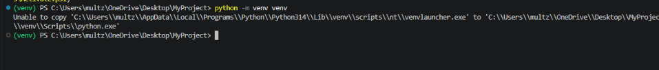

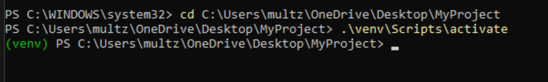
Установка Django:
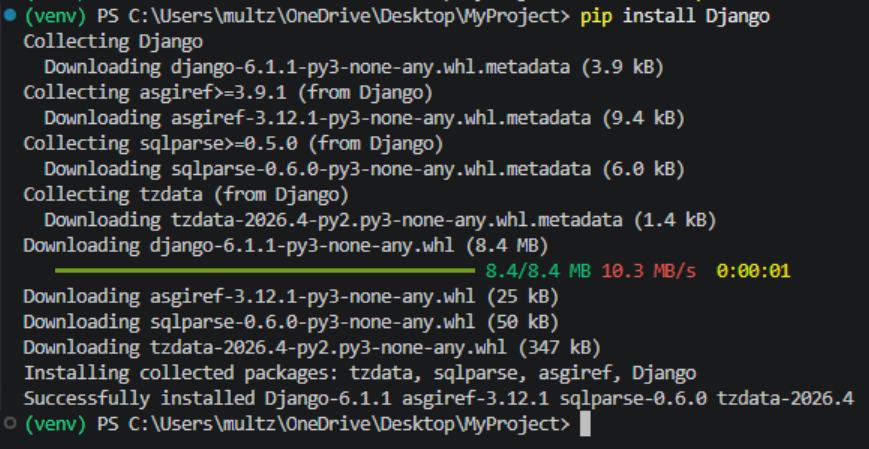
Проверка списка установленных пакетов:
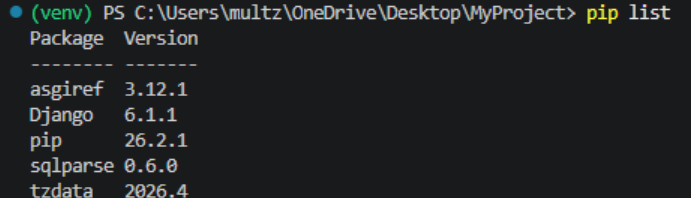
Создание проекта с именем MySite:
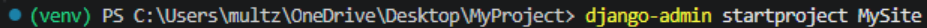

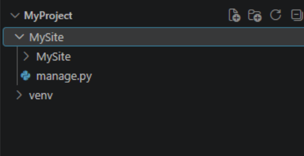
Запуск тестового сервера, чтобы проверить работу:
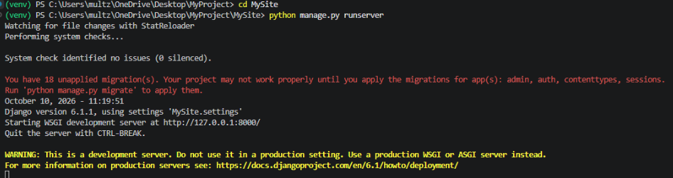

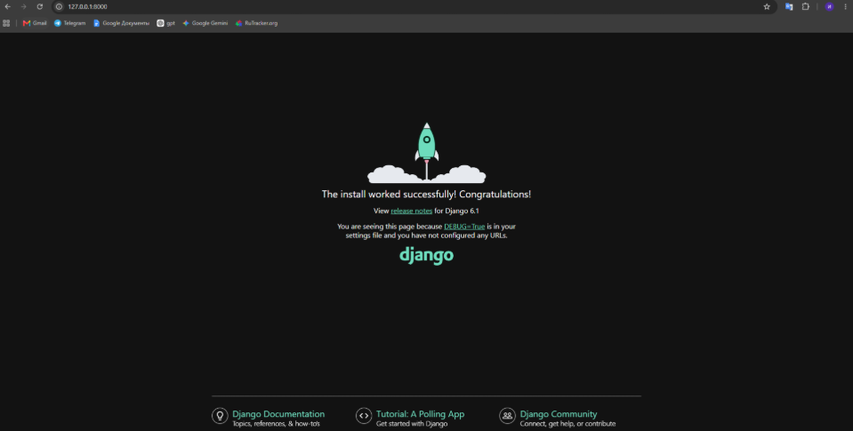
Открыл файл MySite/settings.py. Нашел список INSTALLED_APPS и добавил в конец строку 'news.apps.NewsConfig'
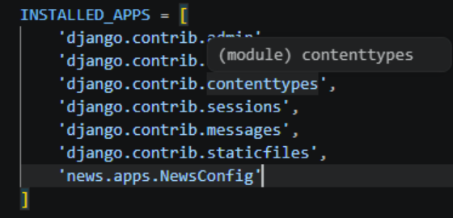
Заменил содержимое news/views.py на следующий код:
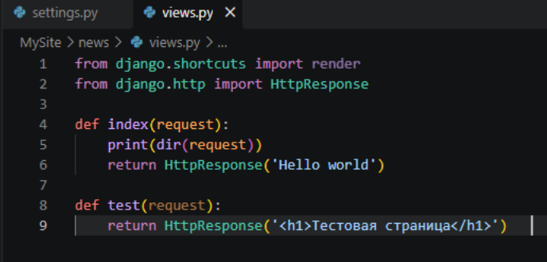
Создал urls.py внутри приложения news. Назвал файл urls.py. 
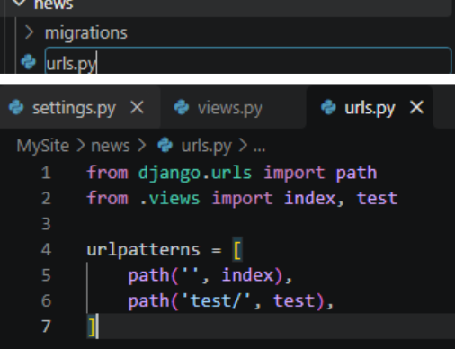
Открыл главный файл маршрутов MySite/urls.py. Импортировал функцию include и добавьте маршрут для news/
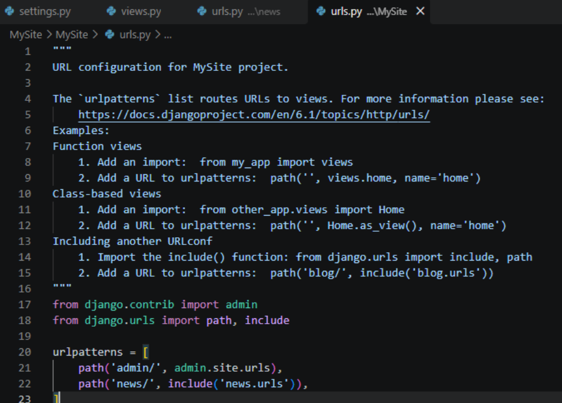
Запуск сервера:
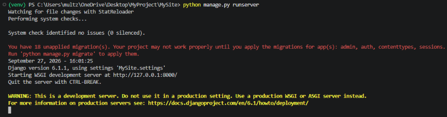
Проверка работоспособности:
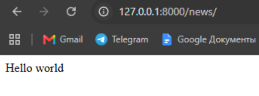

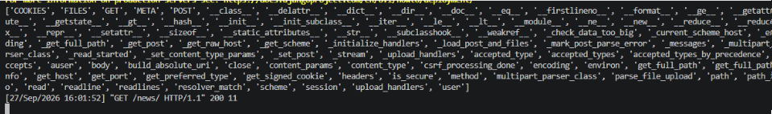

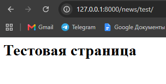

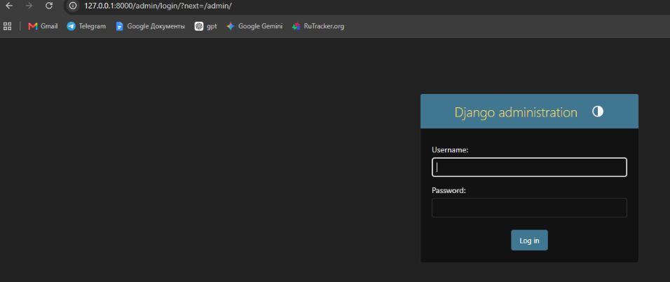